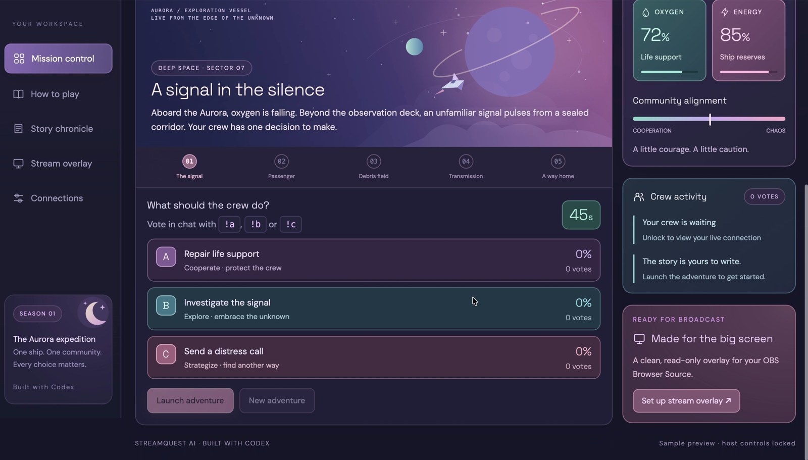
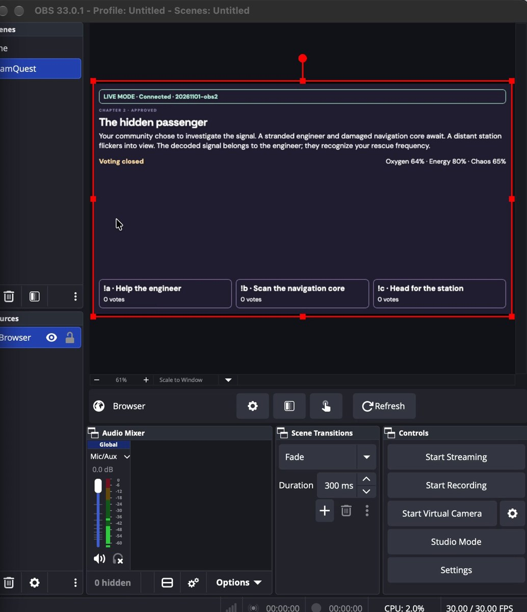
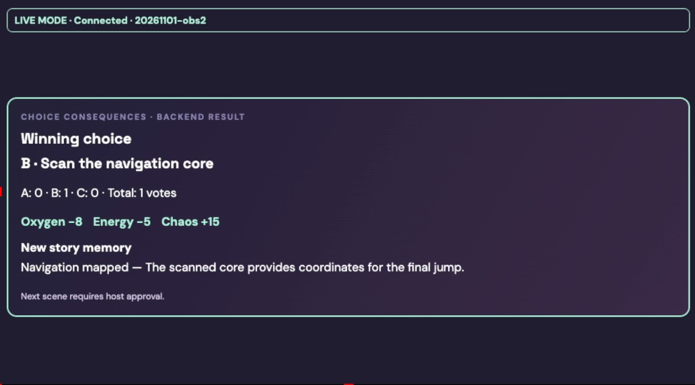
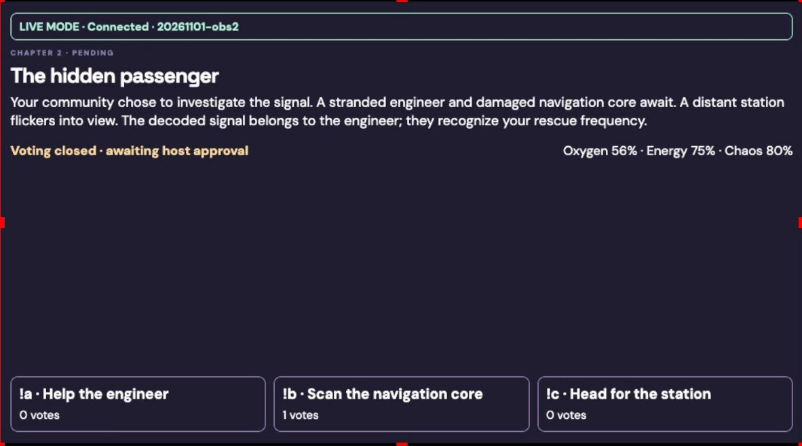
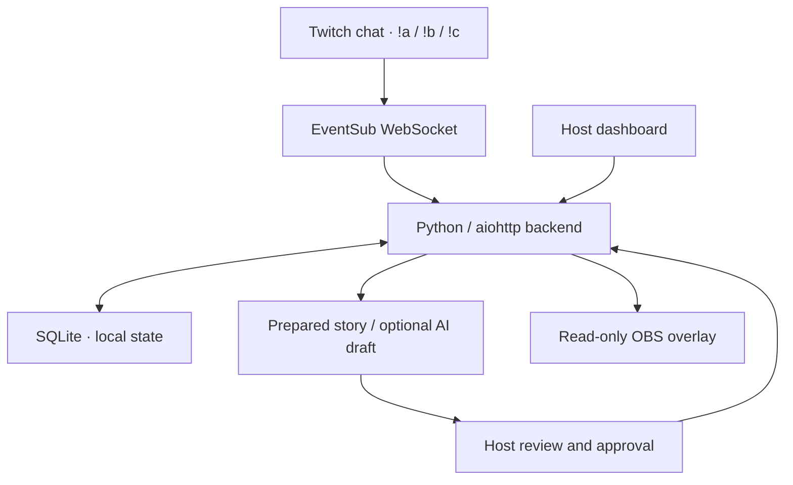

<div align="center">


# StreamQuest AI

### One ship. One community. Every choice matters.

A Twitch adventure where chat chooses the next move—and the story remembers.

[](#quick-start)
[](#connect-twitch)
[](#stream-with-obs)
[](#built-with-codex)

[Explore the interface](#interface-gallery) · [Run locally](#quick-start) · [Connect Twitch](#connect-twitch) · [Verification](#testing--verification)

</div>

---

## Turn your audience into the crew

The **Aurora** is in trouble. Oxygen is falling, a mysterious signal is calling, and the next decision belongs to Twitch chat.

StreamQuest AI gives streamers a five-chapter space adventure their community can control with **`!a`, `!b`, and `!c`**. Choices change oxygen, energy and chaos, create lasting story memories, and influence later chapters and the ending. The host reviews each new scene before it goes on stream.

> **Streamer controls the show. Chat makes the decisions. The adventure remembers.**

## Interface gallery

### Mission control

A colourful host dashboard with story narration, chapter progress, resource cards and live voting controls.



*Dashboard capture from the browser preview; the preview is labelled as sample content.*

### Stream operations · OBS

A separate, read-only Browser Source keeps host controls off the broadcast.

<p align="center"></p>

*Actual OBS capture from the verified `20261101-obs2` revision. The current `20261102-dream1` skin adds dreamy artwork and colourful voting cards; this older capture documents the working integration.*

### Choice Consequences Reveal



*Actual result capture from revision `20261101-obs2`: one vote for B, deterministic resource changes and Navigation mapped.*

<details>
<summary><b>View the approval gate on the stream overlay</b></summary>



The previous chapter stays visible while the host reviews the private draft. Approval advances the broadcast to the next chapter.

</details>

## What makes it different

| Feature | What viewers and streamers experience |
|---|---|
| **Live chat decisions** | Twitch EventSub delivers real chat commands to the backend. One replaceable vote per viewer, per round. |
| **Consequences you can see** | A result reveal displays the selected action, exact totals, actual resource changes and newly gained memories. |
| **A story with memory** | Rescued crew, repaired systems and discoveries affect later scenes, resources and endings. |
| **Host approval** | New narrative stays private until the streamer approves it. |
| **Broadcast-ready overlay** | A dedicated OBS view shows the approved story, timer, choices and results. Targets 1000 × 550 and 1920 × 1080. |
| **Optional AI narration** | An OpenAI-compatible provider can draft narrative. Prepared scenes remain available without an API key. |
| **Local persistence** | SQLite keeps adventure state between runs. Restart pauses active voting. |
| **Accessible motion** | Reduced-motion preferences disable entrance animations. |

## How an expedition works

1. **Launch** the adventure from Mission control.
2. **Open voting** for a 45-second round.
3. **Chat chooses** with `!a`, `!b` or `!c`.
4. **Reveal consequences** when the timer ends or the host closes voting.
5. **Review and approve** the next scene before it appears in OBS.
6. Continue through **five chapters** to the community's ending.

The result window lasts seven seconds from backend close. Polling can delay its first appearance by up to approximately 800 ms. If the host approves during the reveal, the overlay completes the reveal before showing the approved scene.

### Decisions that carry forward

- **Repair life support:** preserves oxygen on later rounds.
- **Rescue the engineer:** restores energy in subsequent chapters.
- **Reinforce shields:** mitigates later damage.
- **Decode signals / scan navigation:** changes later narrative and finale possibilities.

Vote totals and resource effects come from deterministic application logic. AI narration cannot set or alter those values.

## Choose your mode

| | Browser practice | Local Twitch app |
|---|---|---|
| Voting | Simulated viewers | Real Twitch chat via EventSub |
| Storage | Browser local storage | SQLite |
| Story | Prepared branching scenes | Prepared scenes + optional AI narrative |
| Synchronization | Same-origin browser tabs | Backend polling, including OBS |
| Credentials | None | Host key + Twitch application credentials |
| Purpose | Explore the interface | Run an adventure with your channel |

**Use the local Python app for real Twitch integration and OBS.** A hosted static preview does not provide the live backend.

## Quick start

**Requirements:** Python 3.10+, Git, and a Twitch account for live chat. No frontend build or npm installation is needed.

```bash
git clone https://github.com/yasmeenmh90-beep/streamquest-ai.git
cd streamquest-ai
python3 -m venv .venv
source .venv/bin/activate
python -m pip install -r requirements.txt
cp .env.example .env
```

Edit `.env` privately and replace the placeholders. Set a unique **HOST_KEY with at least 16 characters**. Then load your configuration and start:

```bash
set -a
source .env
set +a
.venv/bin/python -m backend.server
```

Open **http://localhost:8080**, then enter the same host key to unlock.

> The server does **not** load `.env` automatically. Source it in the same terminal used to start the server. Keep that terminal running. Copy `.env.example` only on first setup; do not overwrite an existing configuration.

Use shell-compatible quoted values in `.env`. Browser origin and callback settings must match: do not switch to `127.0.0.1` unless the configuration is updated too.

### Configuration reference

| Variable | Purpose |
|---|---|
| `HOST_KEY` | Private host dashboard password, at least 16 characters |
| `APP_BASE_URL` | Browser origin; normally `http://localhost:8080` |
| `TWITCH_CLIENT_ID` | Your registered Twitch application's Client ID |
| `TWITCH_CLIENT_SECRET` | Your Twitch application secret; backend only |
| `TWITCH_REDIRECT_URI` | Normally `http://localhost:8080/auth/callback` |
| `STORY_API_KEY` | Optional runtime narrative provider key |
| `STORY_MODEL` | Optional model supported by your provider |
| `STORY_API_URL` | Optional endpoint; defaults to OpenAI Chat Completions |
| `DATABASE_PATH` | Optional database override; default `data/streamquest.db` |
| `PORT` | Optional local port; default `8080` |

## Connect Twitch

1. [Register a Twitch application](https://dev.twitch.tv/console/apps).
2. Add the exact OAuth redirect URL: **`http://localhost:8080/auth/callback`**.
3. Configure `TWITCH_CLIENT_ID` and `TWITCH_CLIENT_SECRET` in your local environment and restart the server.
4. Unlock the dashboard → **Connections → Connect Twitch**.
5. Authorize the broadcaster account whose chat will host the adventure.
6. Wait for **Connected**, launch an adventure, and open voting.
7. Have viewers send `!a`, `!b` or `!c` in that channel's chat.

The installed-bot setup requests `user:read:chat`, with the same broadcaster/user ID for the EventSub subscription. Unexpected disconnection pauses voting; resume when the connection is healthy. Missed events cannot be recovered.

[Twitch chat authentication](https://dev.twitch.tv/docs/chat/authenticating/) · [EventSub WebSockets](https://dev.twitch.tv/docs/eventsub/handling-websocket-events/)

## Stream with OBS

1. Run and unlock the local app.
2. Open **Stream overlay → Copy URL**.
3. Add an OBS **Browser Source**, with **Local file off**, and paste that URL privately.
4. Set the Browser Source viewport to **1000 × 550** or **1920 × 1080**.
5. Refresh the source cache after UI updates. The current revision badge is **`20261102-dream1`**.
6. Keep the source visible while testing voting, the result reveal and host approval.

The overlay token grants read-only story access. Keep it private. The plain dashboard URL and `?overlay=demo` are not substitutes for your live overlay URL.

<details>
<summary><b>Fix a stale or cropped OBS source</b></summary>

- Restart the server in the same configured terminal.
- Hard-refresh the dashboard and copy the overlay URL again.
- In OBS Properties, click **Refresh cache of current page**.
- If necessary, append `&v=20261102-dream1` to the copied overlay URL.
- Use **Transform → Reset Transform** to remove an existing crop, then fit/position the source.
- Changing the OBS output canvas does not change the Browser Source's own width and height.

</details>

## Optional AI storytelling

Configure `STORY_API_KEY` and `STORY_MODEL` to enable runtime narrative generation. The default endpoint is:

```text
https://api.openai.com/v1/chat/completions
```

The adapter accepts an OpenAI-compatible Chat Completions response. Provider failures or invalid responses retain a prepared fallback. Every next scene—including the ending—requires host approval.

**Codex development and runtime narration are separate:** Codex helps build the application; a story API key optionally generates narrative while the application runs. Runtime API usage can incur separate charges.

## Architecture



| Layer | Implementation |
|---|---|
| Frontend | HTML, CSS, vanilla JavaScript, bundled SVG artwork |
| Backend | Python + aiohttp |
| State and results | Deterministic engine with serialized mutations |
| Persistence | SQLite |
| Twitch integration | Broadcaster OAuth + EventSub chat messages |
| Broadcast | OBS Browser Source, backend polling |
| Development | OpenAI Codex |

## Testing & verification

Run from the project folder:

```bash
.venv/bin/python -m unittest discover -s tests -v
node --check dist/app.js
node tests/test_reveal_ui.cjs
```

Node is needed only for JavaScript checks. Chrome/Chromium is needed for browser layout tests. HTTP tests require permission to bind local loopback ports; tests use temporary databases.

| Evidence | Scope |
|---|---|
| **27 tests passed, no skips** | User-reported local Mac run on 1 November 2026, before the dreamy overlay restyle |
| **243 decision paths** | Automated five-round resource and story-memory coverage |
| **Real Twitch + OBS flow** | Manually confirmed at 1000 × 550 for `20261101-obs2`: votes, result reveal, waiting for approval, next chapter |
| **Current dreamy overlay** | Node checks passed in the development environment; six HTTP tests were blocked by socket permissions and Chrome could not launch there. Fresh visual/layout verification remains needed for this revision. |

These checks cover vote replacement, event deduplication, ties, zero-vote defaults, persistence, permissions, result accuracy and draft redaction. Synthetic events and automated browser tests do not establish real Twitch delivery or an actual broadcast.

See [verification details](docs/VERIFICATION_STATUS.md) and the [live demo checklist](docs/LIVE_DEMO_CHECKLIST.md).

## Rules & local security

- One vote per Twitch user per round; a later valid command replaces that viewer's vote.
- Duplicate event IDs are ignored; invalid or late votes are rejected.
- Ties select the first tied option in A/B/C order.
- Zero votes select default A and are labelled honestly.
- Round closure applies effects once; stale host commands are rejected.
- Host sessions are memory-only: unlock again after restart.
- Twitch refresh credentials are stored locally in SQLite. Protect `data/`.
- Never commit populated `.env` files, tokens, database files or private overlay URLs.
- If a valid credential was shared in an earlier template or recording, rotate it privately.

This backend is intended for **one trusted local streamer**. Public multi-user hosting needs additional authentication, credential-storage and operational hardening.

## Project structure

| Path | Contents |
|---|---|
| `backend/engine.py` | Voting, state transitions and deterministic results |
| `backend/story.py` | Story facts, callbacks, resource effects and endings |
| `backend/server.py` | HTTP API, SQLite, Twitch OAuth/EventSub, narrative adapter |
| `dist/` | Host dashboard, practice mode and OBS overlay |
| `dist/assets/` | Bundled space and moon artwork |
| `tests/` | Engine, HTTP, persistence, UI and layout checks |
| `docs/` | Verification, demo checklist and development notes |

## Built with Codex

OpenAI Codex was used to implement the Choice Consequences Reveal, improve the OBS layout and live-mode labels, add the dreamy overlay styling, and develop regression checks. Local manual testing informed follow-up fixes.

The project began as a ChatGPT-assisted prototype; subsequent implementation and testing work took place in a genuine Codex development thread. Submission material should describe that provenance accurately and use the actual main Codex session ID.

[Codex handoff](docs/CODEX_HANDOFF.md) · [Development history](docs/DEVELOPMENT_HISTORY.md) · [Hackathon rules](https://twitchcon-codex.devpost.com/rules)

---

<div align="center">

**Built by [Yasmeen Azmat Ali](https://github.com/yasmeenmh90-beep)**

*Let chat choose. Let the story remember.*

</div>
